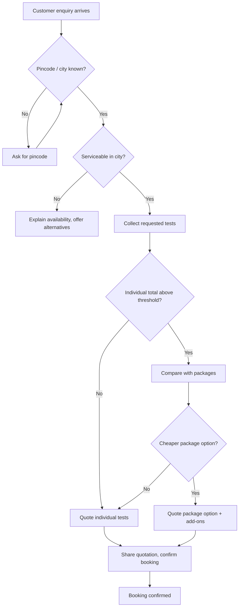

# Booking workflow (as analysed)

## Where manual work occurred
- **Context switching:** agents held the city, tests and quote for several customers in their heads.
- **Price lookup:** agents searched price lists by hand and sometimes used old figures.
- **Package decision:** agents compared individual tests with packages by hand, often inconsistently.
- **Repeated replies:** the same greeting, booking and clarification messages were typed many times a shift.

## Points where the assistant changes the work
- It tracks the facts for each chat separately.
- It shows the next booking step.
- It prepares the quotation from current prices, and marks a missing price as unavailable.
- It shows the package comparison, leaving the decision and the reply to the agent.
